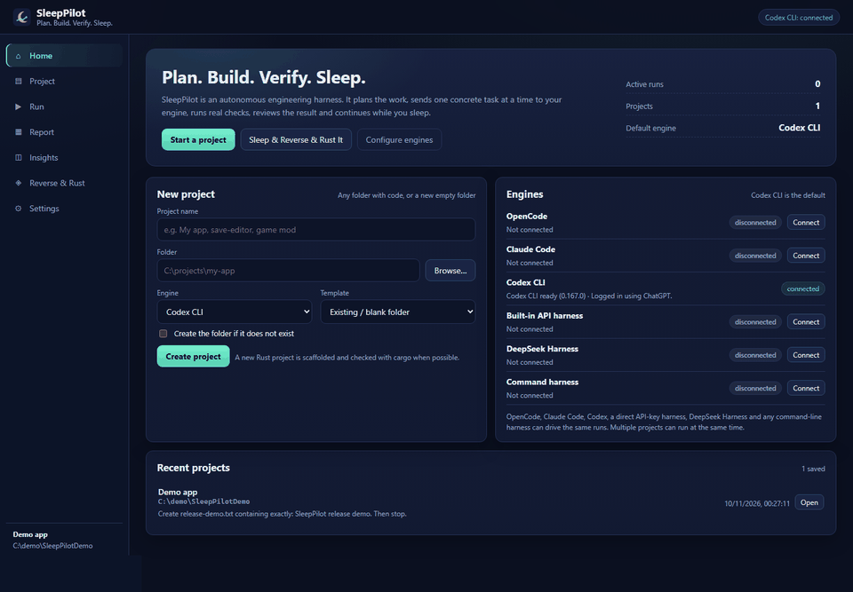
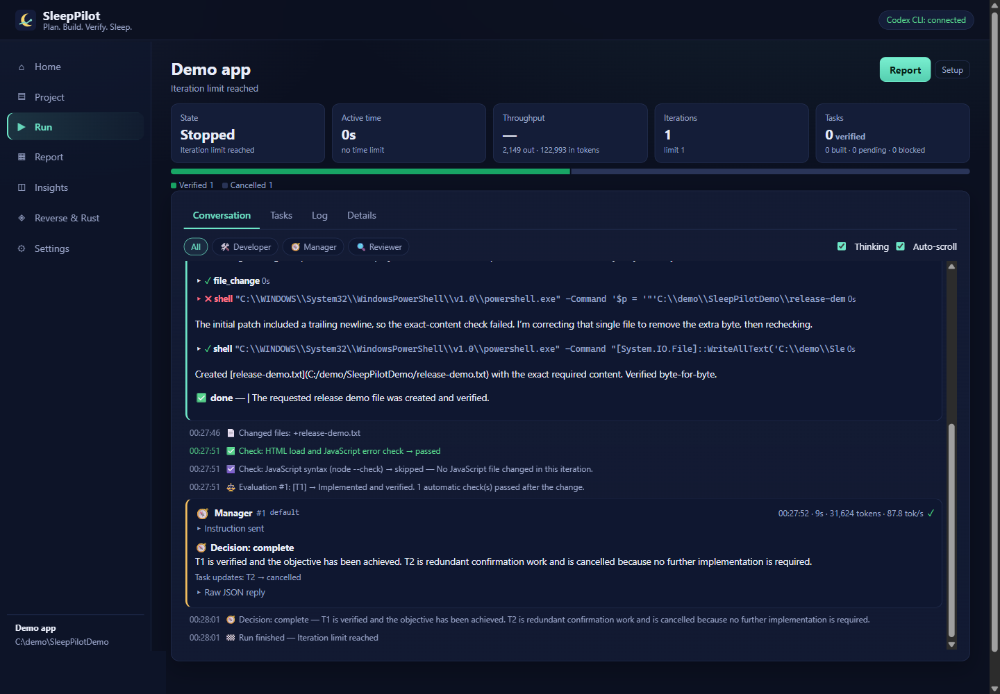
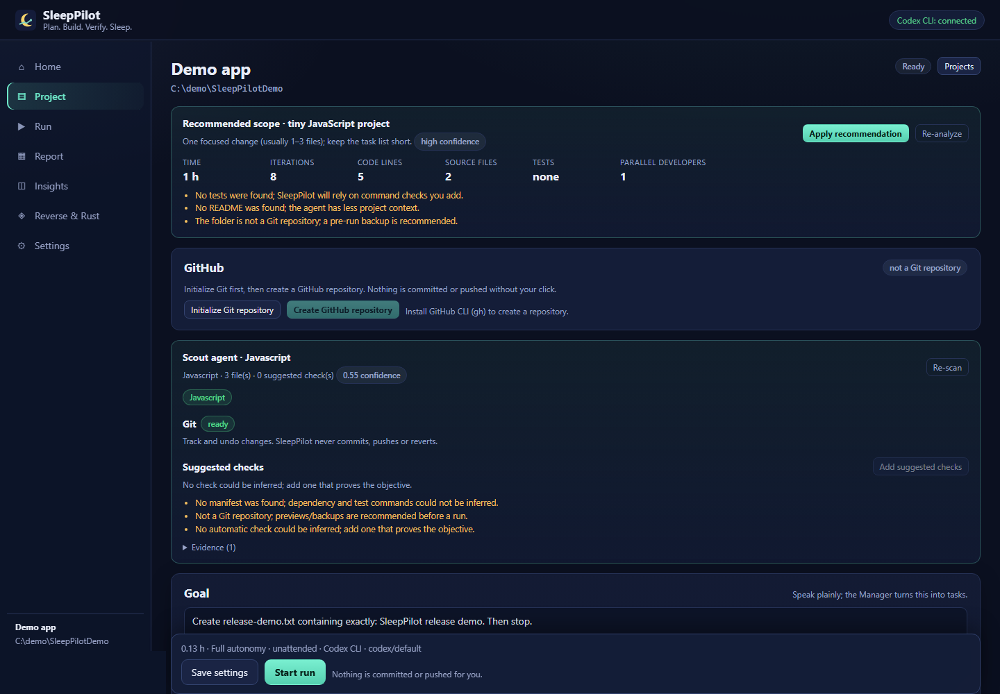

<div align="center">

# SleepPilot

### Plan. Build. Verify. Sleep.

[](https://github.com/akadirsanli/SleepPilot/actions/workflows/test.yml)
[](LICENSE)
[](package.json)
[](package.json)

**Describe the outcome. Go to sleep. Wake up to evidence.**

SleepPilot is a local-first autonomous engineering harness for real repositories.
It plans the work, drives an AI coding engine, runs the checks, asks a reviewer,
recovers from failures, and leaves you a report — instead of leaving you
babysitting a chat window.

[Quick start](#quick-start) · [Why SleepPilot](#why-sleeppilot) · [Multi-harness routing](#multi-harness-routing) · [Documentation](#documentation)

</div>

<p align="center">
  
</p>

## Why SleepPilot

Most coding agents are good at producing a convincing answer. SleepPilot is built
around a harder question: **can it prove the work is actually done?**

- **Evidence beats “done”.** A task becomes **verified** only when checks
  SleepPilot actually executed passed after the change. Model self-reports are
  recorded as claims, never as evidence.
- **It keeps going when things go wrong.** Provider errors, quota exhaustion,
  crashes, frozen turns and app restarts are expected states, not reasons to
  lose the night.
- **Use the harness you already trust.** OpenCode, Claude Code, Codex, a
  built-in API harness, DeepSeek Harness or any command-line agent can execute
  the work.
- **Route the work intelligently.** Pin a different engine, model and reasoning
  effort for the Manager, Developer and Reviewer. If one route is exhausted,
  SleepPilot can continue on another without losing the task.
- **Designed for real repositories.** File-scoped parallel developers, protected
  paths, snapshots, backups, command checks and a read-only reviewer are part of
  the workflow, not an afterthought.
- **No build step. No runtime dependencies.** Node.js and this repository are
  enough.

> **Verified means verified.** “The model said it finished” is not verification.
> SleepPilot wants a passing check, a real file change and a reviewer that has
> seen the evidence.

## A night with SleepPilot

```
objective
   │
   ▼
Manager ──► plan + scope
   │
   ▼
Developer ──► real edits + tools
   │
   ▼
Checks ──► snapshots, commands, syntax, HTML, cargo
   │
   ▼
Reviewer ──► read-only second opinion
   │
   ▼
Manager ──► continue / repair / finish
   │
   └──────────────► repeat until the objective is done or the clock runs out
```

Every turn is durable. Every iteration leaves evidence. Every unexpected failure
gets a recovery path.



## What you can throw at it

- **A feature in an existing app.** “Add CSV export to the active table, keep the
  existing UI style, and verify it with the project’s tests.”
- **A failing test or a stubborn bug.** Give SleepPilot the failure; it plans a
  repair and keeps the change scoped.
- **A migration or refactor.** Parallel developers work only on tasks whose file
  scopes do not overlap.
- **A Reverse & Rust project.** Analyse a program you are authorized to inspect,
  build an evidence-backed dossier and specification, then reimplement it in Rust
  in a separate workspace.
- **A headless job from another tool.** The same orchestrator is available through
  `sleeppilot run`, `ask`, `route` and `reverse` with NDJSON output and stable
  exit codes.

## Six engines, one supervisor

| Engine | Uses | Credential | Best for |
|---|---|---|---|
| **OpenCode 2.x** | A private loopback `opencode serve` process | Reuses your OpenCode sign-in; no key enters SleepPilot | Existing OpenCode users and its tools |
| **Claude Code** | Installed `claude` CLI, stream-json, sessions | Reuses `claude auth login` | Claude Code users, MCP/tools |
| **Codex CLI** | `codex exec --json` + resume | Reuses `codex login` | Codex users and its sandbox |
| **API harness** | OpenAI-compatible or Anthropic HTTP APIs | Your key, stored locally | DeepSeek, OpenAI, OpenRouter, Groq, Mistral, xAI, LM Studio, vLLM |
| **DeepSeek Harness** | Local `dsh --profile headless` | DSH’s credentials | Teams already using DSH |
| **Command harness** | Any command that accepts a prompt | Whatever the command needs | In-house or experimental agents |

**Local AI works too.** Settings → Local AI detects Ollama, lists your local
models and creates a provider in one click — no cloud key required.

## Multi-harness routing

SleepPilot 2.4 can treat several harnesses as one delegation layer.

```js
// project.settings
{
  rolePins: {
    manager:   { harness: 'claude', modelProfile: 'careful' },
    developer: { harness: 'dsh',    modelProfile: 'fast' },
    reviewer:  { harness: 'api',    modelProfile: 'deep-review' }
  },
  modelProfiles: {
    claude: { careful:     { model: 'sonnet', effort: 'high' } },
    dsh:    { fast:        { model: null,     effort: null   } },
    api:    { 'deep-review': { model: { providerID: 'deepseek', id: 'deepseek-chat' }, effort: 'high' } }
  },
  harnessRouting: {
    enabled: true,
    fallbackChain: ['claude', 'dsh', 'api', 'opencode'],
    claudeWindowHours: 5,
    workingWindowHours: 10
  }
}
```

- **Real effort, not a label.** API profiles support `off`, `none`, `minimal`,
  `low`, `medium`, `high`, `xhigh`, `max` and `ultra`; Claude Code supports its
  actual `--effort` values; Codex uses `model_reasoning_effort`.
- **Read-only review at the adapter level.** Manager, Reviewer, closing and
  preflight sessions are restricted to harnesses that can actually enforce it.
- **Quota-aware fallback.** Claude’s 5-hour exhaustion is detected from its
  stream/result output. The failed turn is recorded, the next usable route is
  selected, and the same task continues. A long working window does not end just
  because one harness hit a limit.
- **Loud failures.** Unsupported effort or a harness that cannot enforce
  read-only is rejected with the supported values in the error — never silently
  downgraded.

Detailed schema, effort vocabulary and fallback semantics:
**[docs/ROUTING.md](docs/ROUTING.md)**.

## Quick start

**Requirements:** Node.js **20.10+**. Nothing else is required to open the UI.
Optional tools unlock more engines and checks: OpenCode 2.x, Claude Code, Codex,
Ollama, Rust, Git, GitHub CLI and Microsoft Edge.

```sh
git clone https://github.com/akadirsanli/SleepPilot.git
cd SleepPilot
npm start
```

On Windows you can also run:

```bat
.\SleepPilot.cmd
```

On macOS/Linux:

```sh
./sleeppilot.sh
```

There is **no install step** and **no build step**. SleepPilot has zero runtime
dependencies.

Try the full interface without spending model usage:

```bat
.\SleepPilot.cmd --test-mode
```

The test mode uses simulated engines and is clearly labelled. It keeps its data
separate from your real projects.

All real data — projects, runs, reports, backups and logs — lives under
`%LOCALAPPDATA%\SleepPilot` on Windows or `~/.local/share/SleepPilot` elsewhere.
SleepPilot does not write run data into your project folder; the agent edits the
project only when you give it a task.

## Your first run

1. **Connect an engine.** Settings → Engines: connect OpenCode, Claude Code or
   Codex, add an API key, configure DSH, or use Local AI with Ollama.
2. **Create a project.** Home → New project: choose the folder and, optionally,
   the Rust reverse-engineering template.
3. **Read the scope report.** SleepPilot measures the project, suggests a
   realistic time limit, iteration count and parallelism, and Scout identifies
   the stack, tools and likely checks.
4. **Write the objective.** Say what “done” looks like, including constraints and
   acceptance criteria. Pick a preset: Overnight, Supervised, Strict or
   Unrestricted.
5. **Start the run and go to sleep.** Approve unfamiliar permissions if you are
   watching; use Sleep mode if you are not.
6. **Read the report.** Changed files, executed checks, reviewer verdicts,
   decisions, token usage and open issues — measured, not guessed.



## Headless use

SleepPilot is also a CLI harness for workflows, cron jobs, CI and other agents.

```sh
# Run a project autonomously
node src/main.mjs run --project C:\work\app \
  --objective "Add CSV export" --hours 8 --preset sleep

# One prompt through an engine
node src/main.mjs ask --project C:\work\app --engine api \
  --model deepseek/deepseek-chat --prompt "Fix the failing test" --json

# Resolve routing without executing anything
node src/main.mjs route --project C:\work\app --task coding --dry-run --json

# Reverse & Rust
node src/main.mjs reverse --target C:\games\demo --workspace C:\work\demo-re \
  --mode rust --goal "Rebuild the save editor" --yes --start

# What can this machine do?
node src/main.mjs engines --connect
node src/main.mjs doctor --json
```

`npm link` installs the `sleeppilot` command. Every run/ask/turn emits NDJSON
with `--json`, including `harness`, `modelProfile` and `fallbackStep` on routed
turns. Exit codes are stable: `0` completed, `2` paused, `3` stopped, `4` failed.

## Verification, not vibes

| Evidence | How it is checked |
|---|---|
| Command checks | Exit code of a command you approved |
| JavaScript / Python syntax | Interpreter parse, no execution |
| HTML smoke | Headless Edge: load, console errors, failed resources |
| Documents | Required files exist and contain real content |
| Rust | `cargo check`, `cargo test`, optional clippy/fmt |
| Citations | Every `file:line` claim points at a real line |
| Target integrity | SHA-1 of every reverse-engineering target before/after |

Reviewer verdicts and model “done” messages are recorded, but they are **never
enough** to mark a task verified.

## Sleep mode without the fantasy

The hard part of an overnight run is not starting it. It is keeping it honest
when nobody is watching.

- A **stall watchdog** interrupts turns with no sign of life.
- A **supervisor** and a **memory guard** restart the app after a crash or before
  V8 runs out of memory.
- Sessions are durable; after a restart SleepPilot reconciles an in-flight turn
  from the engine’s records instead of submitting it twice.
- Unanswered permissions and questions are closed after a timeout.
- Quota and provider errors become a controlled pause or a harness switch, not a
  silent failure.
- Nothing is committed or pushed automatically. GitHub actions require an
  explicit click.

## Safety and privacy by default

SleepPilot drives an agent with real file and shell access. Treat it like a
powerful automation tool, not a sandbox.

- The UI server binds to `127.0.0.1` only and uses a per-launch token cookie,
  Host validation and CSRF protection.
- API keys live in a local credential store, never in the project or the browser.
- Claude Code, Codex and OpenCode reuse their own logins; SleepPilot does not
  copy their credentials.
- Manager and Reviewer run read-only where the harness can enforce it.
- Protected paths and per-task edit scopes limit what a developer may touch.
- Pre-run backups are optional; every persisted string passes through a
  redactor.
- Reverse-engineering targets are mirrored read-only and re-hashed to prove they
  were not modified.

Read [SECURITY.md](SECURITY.md) before running an unrestricted profile.

SleepPilot is an independent project. It is **not affiliated with, endorsed by,
or sponsored by** OpenCode, Anthropic, OpenAI, DeepSeek, Microsoft or any other
vendor whose CLI or API it can drive.

## Under the hood

```
UI (vanilla JS, loopback)          CLI / agents / CI
        │                                  │
        └──────────────┬───────────────────┘
                       ▼
              SleepPilotApp + RunController
        plan → developer → checks → reviewer → manager
                       │
          ┌────────────┴────────────┐
          ▼                         ▼
   EngineManager              project / checks / store
   ├─ OpenCode                 ├─ snapshots + diffs
   ├─ Claude Code              ├─ command / syntax / HTML / cargo checks
   ├─ Codex                    ├─ scope analysis + analytics
   ├─ API harness              ├─ reverse mirror + recon
   ├─ DeepSeek Harness         ├─ reports, backups, JSONL history
   └─ Command harness          └─ GitHub status / commit / push
```

The `RunController` is engine-agnostic: it submits turns, reconciles durable
results, evaluates executed checks, applies manager decisions and survives
restarts. Architecture details: [docs/ARCHITECTURE.md](docs/ARCHITECTURE.md).

## Documentation

| Document | What is inside |
|---|---|
| [docs/USAGE.md](docs/USAGE.md) | Install, first run, presets, steering, recovery, CLI |
| [docs/ENGINES.md](docs/ENGINES.md) | Engine contract, providers, Claude/Codex/DSH setup |
| [docs/ROUTING.md](docs/ROUTING.md) | Role pins, model profiles, effort, quota fallback |
| [docs/REVERSE.md](docs/REVERSE.md) | Reverse & Rust: recon, evidence, Rust rules |
| [docs/ARCHITECTURE.md](docs/ARCHITECTURE.md) | State machine, persistence, security design |
| [docs/TESTING.md](docs/TESTING.md) | Unit, integration, fake engines and real tests |
| [docs/LIMITATIONS.md](docs/LIMITATIONS.md) | Known limits and deliberate non-goals |
| [THIRD_PARTY.md](THIRD_PARTY.md) | Tools and ideas SleepPilot works with |
| [SECURITY.md](SECURITY.md) | Credential handling, permissions, disclosure |
| [CONTRIBUTING.md](CONTRIBUTING.md) | Development setup and contribution rules |

## Development

```sh
node test/run.mjs
node src/main.mjs --test-mode --no-open --no-supervisor
```

CI runs the full suite on **Node.js 20, 22 and 24 on Windows**, plus the Rust
recon/check tests on Ubuntu. The suite uses fake OpenCode, API, DSH, Claude Code
and Codex servers/CLIs, so it needs no account and spends no usage. Rust tests
run locally when `cargo` is installed; otherwise the Rust checks report a clear
“cargo not found” message and the rest of the suite still passes.

Real OpenCode tests are opt-in:

```powershell
$env:SLEEPPILOT_REAL=1
node test/run.mjs real
```

## Honest limits

- A harness that cannot enforce read-only sessions (DSH, the Command harness) is
  rejected for Manager/Reviewer roles rather than protected by a prompt alone.
- A harness without a real effort flag rejects effort requests; SleepPilot does
  not pretend to support them.
- `workingWindowHours` defines the intended continuous routing window; the run’s
  own time limit still controls when it ends.
- Model calls cost whatever your provider charges. SleepPilot reports usage but
  cannot make a paid provider free.
- Autonomous modes can change files and run commands. Use scoped permissions,
  protected paths, backups and a version control system you trust.
- Reverse & Rust is for targets you are authorized to inspect. You are
  responsible for the target and for how you use the results.

## Contributing

Issues and pull requests are welcome. Start with [CONTRIBUTING.md](CONTRIBUTING.md),
run the suite, and keep changes small and testable.

If SleepPilot saves you a night, a star helps other people find it.

## License

[MIT](LICENSE). See [THIRD_PARTY.md](THIRD_PARTY.md) for tools and ideas this
project builds on.
