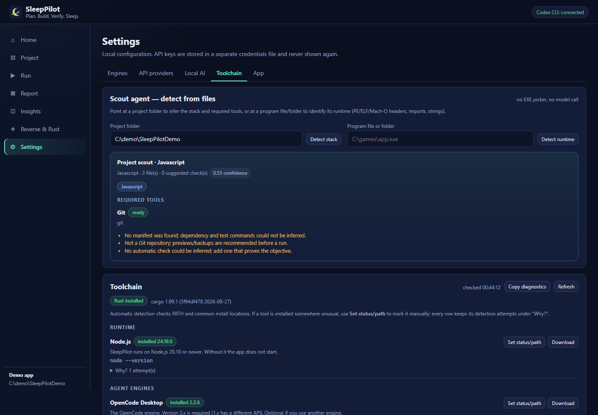

# Engines

SleepPilot’s orchestrator never talks to a provider directly. It submits turns to an **engine** that implements a small, stable contract. Six engines ship in the box, and the same run logic works with all of them.

## The engine contract

Version 2.4.0 adds optional routing fields to the same contract: `createSession({ effort, readOnly })`
and a `quota` object on `runTurn` results. `src/orchestrator/routing.mjs` validates the exact effort
vocabulary per engine; an unsupported value throws instead of being ignored. See
[`ROUTING.md`](ROUTING.md).

| Engine | Effort values | Read-only enforcement |
| --- | --- | --- |
| `api` | off/none/minimal/low/medium/high/xhigh/max/ultra | permissions ruleset |
| `claude` | low/medium/high/xhigh/max | plan mode + disallowed tools |
| `codex` | minimal/low/medium/high | read-only sandbox |
| `opencode` | none | read-only permissions ruleset |
| `dsh` | none (rejects effort) | no adapter-level mode; rejected for read-only roles |
| `cli` | none (rejects effort) | no adapter-level mode; rejected for read-only roles |


```js
engine.status                 // { state, message, version? }
engine.connected              // boolean
engine.models                 // [{ providerID, id, name, context, priceInput?, priceOutput? }]
engine.defaultModel
await engine.connect()
await engine.disconnect()
const s = await engine.createSession({ directory, title, model, permissions })
const turn = await engine.runTurn({ sessionID, text, messageId, metadata, onEvent, onSubmitted })
await engine.turnMessages(sessionID, messageId)   // durable recovery, never resubmits
await engine.interrupt(sessionID)
await engine.listPermissions(sessionID) / replyPermission(sessionID, id, decision)
await engine.listForms(sessionID) / replyForm(sessionID, id, answer) / cancelForm(...)
await engine.usageLimits(directory)               // OpenCode only; others report unsupported
```

`runTurn` returns the common turn result: `status`, `finalText`, `allText`, `tools`, `errors`, `usage`, `transcript` and `snapshotFiles`. The RunController uses this shape for evaluation, chat rendering and recovery; synthetic idle markers in `turnMessages()` let an API, Claude Code, Codex or DSH session be reconciled exactly like an OpenCode session.

A **session** is one project folder + a model + a permission ruleset. The default session policy is *fresh per task*, so each task starts with a clean context. A repair continues the same session unless the policy says otherwise.

## 1. OpenCode (`opencode`)

- Detection: Settings path → `SLEEPPILOT_OPENCODE` → `PATH` → OpenCode Desktop → common install locations.
- Starts a private `opencode serve` on `127.0.0.1` with a random password. Your existing OpenCode sign-in is reused; SleepPilot never reads credential files.
- Uses the server’s own `/openapi.json` to resolve every operation by `operationId`; optional operations are feature-detected.
- Permissions are OpenCode rulesets (`{action, resource, effect}`); the API engine reuses the same rulesets so behaviour is consistent.
- No API key is stored by SleepPilot for this engine.

Requirements: OpenCode **2.x** (1.x is detected and rejected; the API is different).

## 2. Claude Code (`claude`)

SleepPilot runs the **installed Claude Code CLI** headlessly instead of reimplementing its agent:

```sh
claude -p --output-format stream-json --verbose \
  --session-id <uuid> [--model sonnet] --dangerously-skip-permissions
```

- The prompt is sent on **stdin**; Claude Code keeps its own session. Later turns use `--resume <session_id>`.
- `system`/`assistant`/`user`/`result` stream events become the normal SleepPilot chat transcript, tool cards and usage/cost numbers.
- Claude Code’s own **login** (`claude auth login`), MCP servers, tools and settings are reused. SleepPilot does **not** store an Anthropic key for this engine.
- Manager/reviewer turns are read-only through `--permission-mode plan` and a disallow list. Developer turns map the SleepPilot profile to `acceptEdits` (balanced/strict) or bypass permissions (full/unrestricted). Because Claude Code handles its own tool approvals, SleepPilot cannot intercept a Claude permission prompt in headless mode; the selected profile is the boundary.
- Interrupt kills the CLI process tree. A crash mid-turn is reconciled as an interrupted engine turn and never resent.
- Detection: Settings → Engines → Connect, or Toolchain. Set an explicit `claude` path if it is installed outside PATH.

## 3. Codex CLI (`codex`)

SleepPilot runs Codex non-interactively and resumes its thread:

```sh
codex exec --json --skip-git-repo-check --sandbox workspace-write --color never -
codex exec resume <thread_id> --json --skip-git-repo-check -c sandbox_mode="workspace-write" -
```

- `thread.started` gives the thread id; `item.*` events become text, shell, file-change and reasoning entries; `turn.completed` gives token usage.
- Codex keeps its own **login** (`codex login`), model configuration and sandbox. SleepPilot does not store an OpenAI key for this engine.
- Read-only roles use `--sandbox read-only`. Developer turns use the project profile or the configured sandbox; headless runs set `approval_policy="never"` because nobody can answer Codex approval prompts.
- Detection: Settings → Engines → Connect, or Toolchain.

Both CLI engines accept a custom CLI path, model override, timeout and extra arguments in **Settings → Engines**.

## 4. Built-in API harness (`api`)

SleepPilot acts as the harness. It implements the agent loop and tools itself.

### Protocols

| Protocol | Endpoint | Used by |
|---|---|---|
| `openai` | `POST {baseUrl}/chat/completions` | DeepSeek, OpenAI, OpenRouter, Groq, Mistral, xAI, Ollama, LM Studio, vLLM, most gateways |
| `anthropic` | `POST {baseUrl}/messages` | Anthropic Claude |

Streaming (SSE) is used when the provider supports it; a normal JSON response is handled transparently. Native tool calling is preferred; if the provider rejects tool definitions, the engine switches automatically to a fenced text protocol with `tool`-tagged JSON blocks.

### Tools

| Tool | Purpose |
|---|---|
| `read` | Numbered lines from a file (range reads; binary files are described, not dumped) |
| `write` | Create or replace a file |
| `edit` | Exact-text replacement (`oldString` → `newString`) |
| `list`, `glob`, `grep` | Explore the project |
| `bash` | Run a command in the project folder |
| `webfetch` | Fetch a URL as text |
| `question` | Ask the user (disabled in unattended mode) |
| `status` | Report `done` / `blocked` / `needs_user` / `partial` |

The harness appends the developer status line when needed, caps tool output, trims long histories and tracks token usage. Costs are estimated only when the provider model has prices configured.

### Permissions

The API engine evaluates the **same rulesets** as OpenCode (`developerRuleset()` / `readOnlyRuleset()`), with the same last-rule-wins semantics:

- `read` inside the project is always allowed;
- `edit` / `write` / `patch` follow the profile, protected paths and parallel edit scope;
- `shell` follows the profile and the always-deny list (or no list in *Unrestricted*);
- `webfetch` / `question` follow the profile;
- outside paths evaluate `external_directory` too.

When a rule says *ask*, the engine emits a permission request, waits for the UI reply and records the decision. A denied tool is returned to the model as a tool error; it is not an infinite retry.

### Sessions and recovery

Each session is a JSON file under `<data>/engine-sessions/api/`. Every user, assistant and tool message is appended and saved atomically. If the app dies mid-turn, the next start marks that turn **interrupted** and reconciles it from the transcript; the instruction is not sent again.

### Provider configuration

Providers live in `settings.json`; keys live in `credentials.json`. A provider record:

```json
{
  "id": "deepseek",
  "label": "DeepSeek",
  "protocol": "openai",
  "baseUrl": "https://api.deepseek.com/v1",
  "apiKeyEnv": "DEEPSEEK_API_KEY",
  "requiresKey": true,
  "enabled": true,
  "maxOutputTokens": 8192,
  "models": [{ "id": "deepseek-chat", "name": "DeepSeek Chat" }]
}
```

At connect time the engine tries `GET {baseUrl}/models` and merges that list with the configured models. Presets are in `src/engines/api/providers.mjs`; add a new one there and it appears in Settings.

### Local AI with Ollama

**Settings → Local AI** detects the Ollama binary and service, lists installed models from `/api/tags`, and writes an `ollama` provider (base URL `http://127.0.0.1:11434/v1`, no API key) with one click. The normal Project screen then offers those models.

- Default host: `http://127.0.0.1:11434` (override in Settings or with `OLLAMA_HOST`).
- The service must be running (`ollama serve`); models are pulled with `ollama pull <model>`.
- Tool calling depends on the model. Models trained for tools (Qwen2.5-Coder, Llama 3.1, Mistral, …) are the best choice; SleepPilot falls back to its text tool protocol when native tool calls are unavailable.
- The OpenAI-compatible endpoint is used for turns; only the discovery calls are Ollama-specific.
- A fully local run needs no cloud account. A small coding model is enough for small tasks; large repos still need a larger model.

## Toolchain detection and manual overrides



**Settings → Toolchain** checks each tool by trying its bare command plus the common install
locations (`%USERPROFILE%\.cargo\bin`, `%LOCALAPPDATA%\Programs`, `%ProgramFiles%`, Scoop shims,
npm/pnpm global bins, Python `Python3*` folders, and so on). Every row records its attempts under
**Why?**, so a failure says which paths were tried.

When automatic detection is wrong or impossible:

- **Set status/path** → *Installed* with a path or command, *Missing*, or *Ignore*.
- A manual path is verified with the tool's version probe when one exists; a wrong path is shown as
  a problem instead of being silently accepted.
- Manual choices are stored in `settings.json` (`toolOverrides`) and survive restarts.
- *Use auto* removes the override.

The **Scout agent** on the same screen detects a project stack from manifests/source files and a program runtime from its own PE/ELF/Mach-O headers, imports and strings. It returns the required tools with live status plus suggested checks. Probes run in parallel and results are cached for 30 seconds.

The same catalogue drives the Rust/Reverse checks and the Ollama provider setup.

## 5. DeepSeek Harness (`dsh`)

The `dsh` engine wraps the local DeepSeek Harness CLI:

```sh
dsh --profile headless --json --approval-policy never --session-id <id> -
```

- The prompt is sent on stdin (`-`); the project folder is the working directory.
- NDJSON events are streamed to the UI (`session`, `text`, `tool`, `status`, `final`).
- The DSH session id is persisted and passed with `--session-id` on later turns, so repairs continue the same DSH conversation.
- Interrupts kill the process tree.
- Credentials come from the DSH environment; SleepPilot can store env values (e.g. `DEEPSEEK_API_KEY`) in its credential store and passes them to the child process.
- Approval policy defaults to `never` for unattended runs; `ask` is available in Settings.
- `dsh` runs its own tool loop; SleepPilot supervises at the task level and evaluates the resulting files with its own checks.

This is the reference integration for “another DeepSeek harness”. A harness that can print a small NDJSON stream can be adapted in `src/engines/dsh/engine.mjs` or through the command harness.

## 6. Command harness (`cli`)

Any CLI that accepts a prompt:

```
command: claude
args:    -p {prompt}
promptVia: arg
```

or

```
command: my-harness
args:    --dir {project} --json
promptVia: stdin
```

Placeholders: `{prompt}`, `{project}`, `{model}`, `{sessionId}`. One process per turn. The engine stores stdout as the turn text and stderr as the error. It is intentionally simple: use it for harnesses that do not expose a session API, or wrap a proprietary tool.

## Adding an engine

1. Extend `AgentEngine` from `src/engines/base.mjs`.
2. Implement `connect`, `disconnect`, `createSession`, `runTurn` and `turnMessages` (the minimum for recovery).
3. Add the engine to `EngineManager.createEngines()` and to `ENGINE_IDS` in `src/settings.mjs`.
4. Emit `status` events and keep `models` in the standard shape.
5. Add a fake server and an integration test (`test/fake-*`, `test/integration/*`).

The orchestrator, UI, reports and CLI need no changes.

## Engine selection

- Global default: Settings → Engines → *Make default* (or `settings.engine`).
- Per project: Project screen → Engine.
- Per run: the run record stores the engine id/label/version, so reports and recovery are unambiguous.
- One run per project, multiple projects at once (default global limit 3; configurable in Settings → App). Each active run keeps a distinct engine session and evidence folder.
