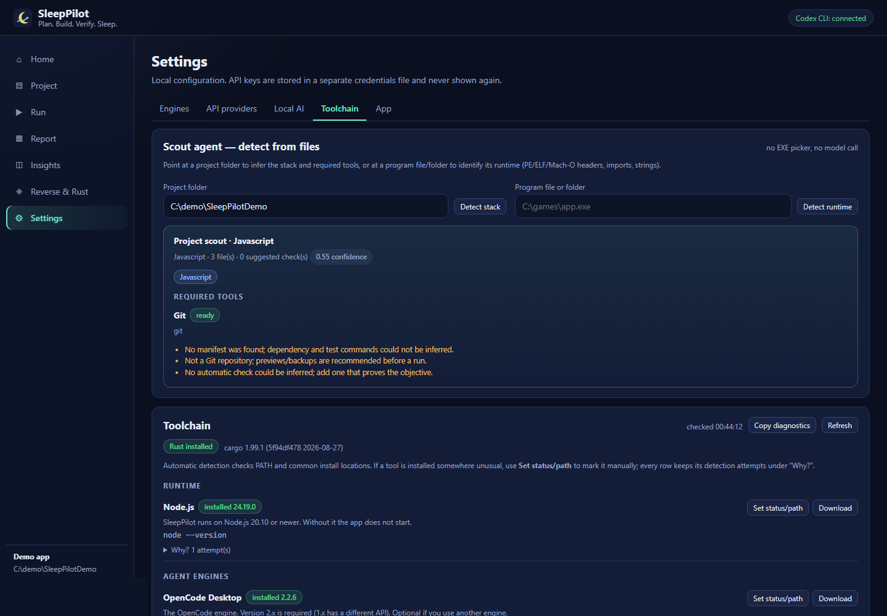
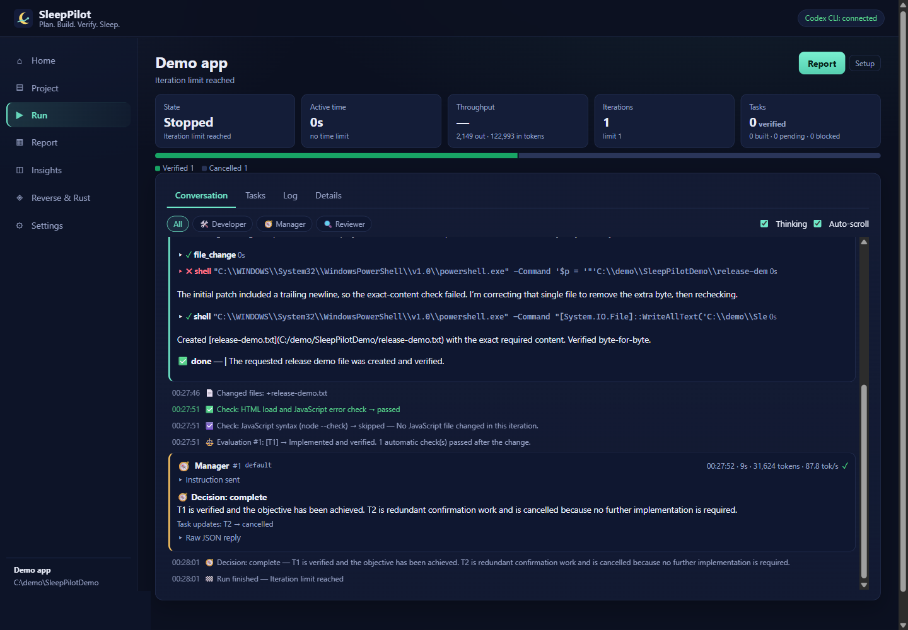

# SleepPilot user guide

## 1. Install

- **Node.js 20.10+** is required. SleepPilot has no npm dependencies.
- **Windows:** double-click `SleepPilot.cmd` (or run `node src/main.mjs`). A console window stays open; closing it stops the app and any active run.
- **macOS/Linux:** run `./sleeppilot.sh`.
- **Optional:** OpenCode 2.x, Claude Code (`npm install -g @anthropic-ai/claude-code`), Codex CLI (`npm install -g @openai/codex`), Rust (`rustup.rs`, for Rust It), GitHub CLI (`gh`, for repository creation), Microsoft Edge (app window and HTML check), Git, Python.

Data lives in `%LOCALAPPDATA%\SleepPilot` on Windows and `~/.local/share/SleepPilot` elsewhere. Override it with `SLEEPPILOT_HOME` (used by the tests).

## 2. Engines

Open **Settings → Engines** and connect at least one engine.

| Engine | Setup |
|---|---|
| OpenCode | Install OpenCode Desktop/CLI 2.x and sign in. SleepPilot auto-detects it; set a path if needed. It starts a private `opencode serve` on loopback with a random password. |
| Claude Code | Install the `claude` CLI and run `claude auth login` once. SleepPilot runs it headlessly with stream-json and resumes its own session. Set the CLI path/model/permissions under Settings → Engines. |
| Codex CLI | Install the `codex` CLI and run `codex login` once. SleepPilot runs `codex exec --json` and resumes the thread. Set the sandbox/model under Settings → Engines. |
| Built-in API | Settings → API providers → *Add provider*. Choose a preset (DeepSeek, OpenAI, Anthropic, OpenRouter, Groq, Mistral, xAI, Ollama, LM Studio or custom), set the base URL and model ids, then save the key. |
| DeepSeek Harness | Install DeepSeek Harness. SleepPilot auto-detects `dsh.cmd`; set the CLI path if needed. Store `DEEPSEEK_API_KEY` in Settings if the headless profile needs one. |
| Command harness | Enter a command and arguments. `{prompt}`, `{project}`, `{model}` and `{sessionId}` are replaced. |

Claude Code and Codex keep their own login, tools and sandbox. SleepPilot cannot intercept their internal permission prompts in headless mode; choose the CLI permission/sandbox in Settings → Engines. Both accept a custom CLI path if they are installed outside PATH.

A project can choose its own engine; the **default engine** applies to new projects. `Test / connect` shows the real status and loads the model catalogue.

### Local AI with Ollama

Open **Settings → Local AI**:

1. SleepPilot detects whether Ollama is installed and running. If it is not running, start it (`ollama serve`).
2. Pull a model once, e.g. `ollama pull qwen2.5-coder:7b`.
3. Click **Add as API provider**. The discovered models become an `ollama` provider (no API key).
4. In a project, select the **API** engine and the `ollama/...` model for the roles you want.

A fully local run needs no cloud account. Tool calling quality depends on the model; Qwen2.5-Coder, Llama 3.1 and Mistral are good starting points. SleepPilot falls back to a text tool protocol when a model cannot call tools natively.

### Toolchain detection



**Settings → Toolchain** checks PATH and common install locations (including `%USERPROFILE%\.cargo\bin`, `Program Files`, `%LOCALAPPDATA%\Programs`, Scoop, npm/pnpm global bins and Python `Python3*` folders). If a tool is still not detected:

- open **Why?** on the row to see every attempted path and error;
- click **Set status/path** and choose *Installed* with the real path or command (or *Missing* / *Ignore*);
- a manual path is verified with the tool's version probe; a bad path is shown as a problem;
- **Use auto** clears the override.

Manual overrides are stored in `settings.json` and survive restarts. **Copy diagnostics** copies the whole toolchain report (including Scout results) for a bug report.

The **Scout agent** section on the same tab can infer the toolchain without an EXE picker:

- **Detect stack** on a project folder reads `package.json`, lock files, `Cargo.toml`, `pyproject.toml`, `go.mod`, `.sln`/`.csproj`, `pom.xml`/Gradle, CMake/Make, Docker, Godot, Unreal, Swift, Dart and source extensions. It lists the required tools with live status and suggests test/build checks.
- **Detect runtime** on a program file/folder reads PE/ELF/Mach-O headers, imports and strings. It identifies .NET/Unity, Electron/Node, Python-packed, Java, Go, Rust, toolchain executables and native binaries, then recommends reverse-engineering tools.
- Missing tools link to their official install page. A project Scout report also appears on the Project screen with **Add suggested checks**.

### Scout agent

Scout is a deterministic, read-only internal agent: it makes no model calls and does not modify the project. It records its profile on the run and in the report. The Project screen shows its stack, frameworks, required tools, suggested checks, risks and evidence; **Add suggested checks** imports the suggestions as disabled/unapproved checks that you can review.

### API keys

Keys are stored in `credentials.json` under the SleepPilot data folder (mode `0600` where the OS supports it), **not** in `settings.json`, and are never returned to the UI. Environment variables are used as a fallback (`DEEPSEEK_API_KEY`, `OPENAI_API_KEY`, `ANTHROPIC_API_KEY`, …). Local providers (Ollama, LM Studio) need no key.

## 3. Create a project

**Home → New project**

- **Folder** — an existing project folder or a new empty folder. Tick *Create the folder* if needed. With a **workspace** (Settings → Workspace) the folder is optional: the project is created in `<workspace>/projects/<name>`.
- **Engine** — the backend for this project.
- **Template** — *Existing / blank folder*, *Web app*, *New Rust project* or one of the Android templates (native Kotlin, HTML/JS in an Android shell, libGDX 3D game). The Rust template writes a working Cargo crate (library + CLI + acceptance tests), runs `cargo check` when cargo is available and enables `cargo check` / `cargo test` checks. Web and Android templates add a page-load check or the Android build check, an `AGENTS.md` for the agent and the preview settings — see [ANDROID.md](ANDROID.md).

Opening the same folder again reuses its project record. Each project’s runs, reports and configuration are stored separately.

### Upfront scope analysis

When a project opens, SleepPilot measures it locally (code files, lines, tests, TODOs, generated folders and risks) and shows a **Recommended scope** card. For a new project, it says the folder is tiny and suggests a short run; for a large codebase it recommends a longer limit, more iterations and a narrower first scope. Click **Apply recommendation** to fill the time limit, iteration count, parallel developers, permission profile and unattended flag. Nothing is saved until you click **Save**.

The same analysis is available for a Reverse & Rust target with **Analyze target scope** before the workspace is created; it reports files, text/binary counts, recon time and a suggested run length. The same button also asks Scout to read the program itself, so the preview shows its runtime/framework and the reverse-engineering tools it needs.

On the Project screen, the **Scout agent** card reads the project's own manifests and sources. It shows the stack and required tools (with live installed/missing status) and offers suggested checks. Nothing is installed or enabled automatically.

## 4. Configure and start a run

On the **Project** screen:

- **Goal** — what should be built, fixed or analysed. Include constraints, acceptance criteria and anything that must not change.
- **Additional rules** — project-specific rules for the agents.
- **Preset**
  - **Overnight** — full autonomy, unattended, 2 parallel developers, closing report, retries transient errors.
  - **Supervised** — reads/builds/tests run freely, other commands ask; best while you are at the computer.
  - **Strict** — every command and outside folder asks.
  - **Unrestricted** — no permission checks, no deny list; your responsibility.
- **Time limit**, **permission profile**, **models** per role.
- **Advanced** — iteration/turn limits, final-answer grace, overtime, parallel developers, scope mode, reviewer, closing report, backup, carry-over, plan review, protected paths and checks.

Checks are the evidence. A command check is a command you approve to run after a task; syntax, HTML, document and Rust checks are built in. A task cannot be “verified” without an executed passing check.

Click **Start run**. The **Run** screen opens.

### Multiple projects

Different projects can run at the same time (default limit **3**, change it in **Settings → App**). A project can still have only one active run. The Home screen lists active runs and the Run screen shows a shortcut bar to switch between them. Engines keep a separate session per run; closing SleepPilot saves all active runs.

### GitHub

The **Project** screen has a GitHub card:

- **Initialize Git repository** if the folder is not a repository.
- **Create GitHub repository** uses the GitHub CLI (`gh`) and your existing `gh auth login`; it can create the repository and push the first commits.
- **Commit & push…** explicitly stages all files, creates one commit and pushes to `origin`. Review secrets and generated files first.
- **Refresh** shows the branch, remote, uncommitted changes, GitHub CLI sign-in and repository details.

Nothing is pushed automatically. If `gh` is missing, the card explains that creating a repository requires it; `git push` still works with your existing credentials once an `origin` exists.

## 5. During a run



- **Conversation** shows every Manager / Developer / Reviewer turn, the tools used, the model’s reasoning and the final answer. Use the steering box to change direction:
  - *Apply now* interrupts the current developer turn.
  - Otherwise the instruction is applied after the current iteration.
- **Tasks** — edit, reprioritise, cancel, reopen or add tasks; “Do first” puts one at the front.
- **Log** — the raw event stream.
- **Details** — engine, models, token usage, cost estimate, protected paths, instructions applied and settings changed during the run.
- **Pause / Pause now**, **Stop / Stop now**, **+1 hour**.
- Pending permissions and questions appear at the top. In unattended mode they are answered/declined automatically after the permission timeout.
- If *Review the plan before starting* is enabled, the run pauses after planning; review the task list and click **Approve plan and start**.

Closing the browser window does not stop a run. Closing the console window stops SleepPilot. You can also right-click anywhere in the app (not inside an input) for a context menu with **Close SleepPilot**, **Close this window** and **Reload interface**. Closing SleepPilot saves active runs as cleanly stopped, so they will not resume by themselves.

### Live preview

The **Preview** screen shows the project's web app while the agent writes it (phone, tablet, desktop or full size) and reloads on every saved file; JavaScript errors appear in its console panel. A run starts the static preview by itself. Projects built by a bundler (Vite, Next.js, …) run their own dev server after you approve the command. Details: [ANDROID.md](ANDROID.md#live-preview).

### Android

The **Android** screen builds APKs and Play Store bundles, explains build errors, signs release builds, installs the app on a USB-connected phone and lets the phone download the APK. Details: [ANDROID.md](ANDROID.md#android-builds).

### Control SleepPilot from your phone

Leave the PC on with SleepPilot running and use your phone as the remote.

1. Install [Tailscale](https://tailscale.com) (free) on the PC and on the phone and sign in with the same account on both.
2. In SleepPilot open **Settings → Phone** and click **Turn on phone access**. If Windows asks whether Node.js may use the network, allow it.
3. Scan the QR code with the phone camera. Add the page to the home screen; the phone stays signed in.

From the phone you can start runs, pause, stop, add time, steer, edit tasks and answer permissions and questions, at home or away. SleepPilot listens only on the PC's Tailscale address, so it is never reachable from the Wi-Fi or the internet. The phone cannot see or change API keys, open the folder dialog, close SleepPilot or change phone access; do those on the PC.

The QR code is the key: do not share a photo of it. **Sign out all phones** makes a new one. If the page shows *Waiting for Tailscale*, Tailscale is not running or not signed in on the PC; SleepPilot checks again every minute.

## 6. After the run

The **Report** screen shows:

- measured source lines added/removed and changed files;
- tasks verified / built-but-unverified / failed;
- per-iteration checks, reviewer verdict and manager decision;
- token and cost estimates;
- the engine’s closing report;
- for Reverse & Rust runs, target integrity and the recon summary.

Reports are also written as `report.md` under the run folder. A **Read-only** reviewer and the closing report may be the same model as the developer; treat their prose as commentary, not evidence.

### Insights

**Insights** aggregates measured data across all projects: active hours, source lines added/removed, verified tasks, tokens and estimated cost, activity over the last 14 days, the most-active projects, the projects that wrote the most, engines/models used and recent runs. Only real run records are used, not model claims.

## 7. Sleep mode and recovery

Sleep mode is the default in the **Overnight** preset:

- questions are denied and unanswered permission requests are rejected after the timeout;
- transient provider/connection/rate-limit errors retry with backoff;
- quota/auth/configuration pauses are explained and can resume automatically when configured;
- a crash or freeze is followed by a supervisor restart; the run resumes after a delay without resubmitting the in-flight instruction;
- when the time limit passes during a turn, the last answer is awaited (up to *final grace*), checks run, then the run finishes.

A *clean* app shutdown leaves the run paused until you press **Resume**. A crash/kill during an unattended run is recovered automatically (bounded per run).

## 8. Reverse & Rust

See [REVERSE.md](REVERSE.md). Short version:

1. **Reverse & Rust → New workspace**.
2. Enter the target file/folder (read-only) and a separate workspace.
3. Optionally click **Analyze target scope** to see file/binary counts, recon time and a recommended time limit.
4. Choose **Analyze + Rust It** (recommended) or **Analyze**.
5. Confirm you are authorized to analyse the target.
6. Review the objective and start the run.

The workspace gets `_target/` (mirror), `_recon/` (reconnaissance), a Cargo project (Rust mode), and the agent writes `INVENTORY.md`, `ARCHITECTURE.md`, `ALGORITHMS.md`, `FORMATS.md`, `SPEC.md` plus the Rust implementation and tests.

## 9. Command line

```
sleeppilot                              open the UI (default)
sleeppilot run [options]                autonomous project run
sleeppilot ask [options]                one prompt through an engine
sleeppilot route [options]              resolve harness/model routing without executing
sleeppilot reverse [options]            prepare a Reverse & Rust workspace
sleeppilot engines [--connect] [--json] show engine/provider/toolchain status
sleeppilot doctor [--json]              check the machine setup
sleeppilot web [--port N]               start the UI server without a window
sleeppilot help | version
```

Common options: `--engine opencode|claude|codex|api|dsh|cli`, `--model provider/model`, `--model-profile <name>`, `--provider <id>`, `--api-key <key>`, `--base-url <url>`, `--json`, `--quiet`, `--verbose`.

### Multi-harness routing

The Project screen’s **Multi-harness routing and model profiles** section pins a harness and model
profile per role, sets a fallback chain, and edits the JSON profiles. For example, Manager on Claude
with `high`, Developer on DSH, Reviewer on the API with a DeepSeek reasoning profile. Every turn and
the run header show the active harness/model profile; routing switches are recorded. The headless
CLI uses the same profiles with `sleeppilot ask --model-profile <name>` and
`sleeppilot run --model-profile <name>`. See [`ROUTING.md`](ROUTING.md) for the schema and the exact
effort vocabulary.

> `--api-key` is convenient for one-off runs, but command lines are visible to other processes and may be kept in shell history. Prefer the Settings UI, `credentials.json`, or the provider’s environment variable for regular use.

### run

```
sleeppilot run --project C:\work\app --objective "Add CSV export" \
  --hours 8 --preset sleep --parallel 2 --engine opencode
```

- `--create` creates the project record if it does not exist.
- `--objective` accepts text, `@file` or `-` for stdin.
- `--preset sleep|supervised|strict|unrestricted`, `--hours`, `--iterations`, `--parallel`, `--no-reviewer`, `--no-report`.
- Exit codes: `0` completed, `2` paused/waiting, `3` stopped, `4` failed.

### route

Resolve which harness/model/profile each role would use, without connecting or executing:

```bat
sleeppilot route --project C:\work\app --task coding --dry-run --json
```

The JSON includes `roles.manager/developer/reviewer/closing/preflight`, each route's `harness`,
`modelProfile`, `model`, `effort` and `fallbackStep`, plus the full `fallbackChain` and
`workingWindowHours`. Unsupported effort or a missing profile fails loudly with an error.

### ask

```
sleeppilot ask --project C:\work\app --engine api \
  --model deepseek/deepseek-chat --provider deepseek \
  --model-profile deepseek-high \
  --prompt "Fix the failing test" --permission full --json
```

One turn, one answer. This is the simplest way to use SleepPilot as a harness from another tool.

### reverse

```
sleeppilot reverse --target C:\games\demo --workspace C:\work\demo-re \
  --mode rust --goal @goal.md --yes --start --hours 10
```

`--yes` confirms authorization; `--start` launches the run immediately.

## 10. Troubleshooting

| Symptom | What to do |
|---|---|
| Engine shows `disconnected` | Settings → Engines → *Test / connect*; check the message, path, base URL and key. |
| `file argument must be of type string` | Fixed in 2.3.0. If you see it, update to 2.3.0+, open Settings → Engines, click *Test / connect* for the engine, then start a new run. |
| API engine says “no API key” | Add the key in Settings → API providers, or set the provider’s environment variable. |
| `cargo was not found` | Install Rust from https://rustup.rs/ and refresh Settings → Toolchain. It now checks `%USERPROFILE%\.cargo\bin`; if you use a custom location, open the row → **Set status/path** and set it manually (or set `CARGO`). |
| A tool is installed but not detected | Settings → Toolchain → **Why?** shows the paths tried. Use **Set status/path** to point at it. |
| Scout cannot identify the stack | Check that the folder contains a manifest (`package.json`, `Cargo.toml`, `pyproject.toml`, …). For a program, point at the actual `.exe`/binary; packed or unusual files may only expose generic headers. |
| A suggested check is wrong | Scout suggestions are disabled and unapproved by default. Review, edit or delete them in the project checks before enabling. |
| Ollama is not detected | Settings → Local AI: make sure the service runs (`ollama serve`), set the host if it is not `127.0.0.1:11434`, then **Refresh**. |
| Ollama has no models | `ollama pull qwen2.5-coder:7b` (or another model), then **Refresh** and add the provider. |
| OpenCode not found | Set the OpenCode path in Settings → Engines, or install OpenCode Desktop 2.x. |
| Claude Code not found / not signed in | Install `@anthropic-ai/claude-code`, run `claude auth login`, then Settings → Engines → Connect (or set the CLI path). |
| Codex not found / not signed in | Install `@openai/codex`, run `codex login`, then Settings → Engines → Connect (or set the CLI path). |
| GitHub CLI not found | Install `gh` from https://cli.github.com/ and run `gh auth login`. Without it, **Initialize Git** and **Commit & push** still work if an `origin` remote exists. |
| Push fails | Check the branch and remote in the GitHub card, and make sure Git has `user.name` / `user.email` configured. |
| A run is paused | Read the pause message. Quota/auth/configuration errors need your action; transient errors resume automatically in sleep mode. |
| The app was restarted | Runs are paused; press **Resume**. The unfinished instruction is reconciled, never resent. |
| The UI does not open | Run `SleepPilot.cmd --no-open`, open the printed URL, and check the console for errors. |
| A task is “built, not verified” | Add a command check that proves the task, or check it by hand. |
| Unwanted changes | SleepPilot never commits or pushes automatically. Review the GitHub card before clicking **Commit & push**; use the pre-run backup under the SleepPilot data folder. |

Self-check: `node src/main.mjs doctor`.
